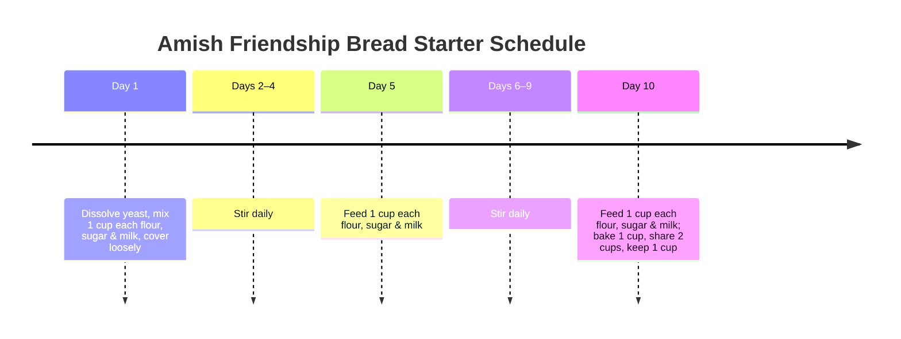

# :microbe: Amish Friendship Bread Starter

![Amish Friendship Bread Starter][1]{ loading=lazy }

| :fork_and_knife_with_plate: Serves | :timer_clock: Total Time |
|:----------------------------------:|:------------------------:|
| 4 cups | 10 days |

## :salt: Ingredients

- :microbe: 1 package (0.25 oz / 7 g) active dry yeast
- :droplet: 0.25 cup (57 g) warm water (110°F / 45°C)
- :bread: 3 cups (360 g) all-purpose flour, divided (1 cup / 120 g each on Days 1, 5, and 10)
- :candy: 3 cups (594 g) granulated sugar, divided (1 cup / 198 g each on Days 1, 5, and 10)
- :glass_of_milk: 3 cups (681 g) milk, divided (1 cup / 227 g each on Days 1, 5, and 10)

## :cooking: Cookware

- :bowl_with_spoon: 1 small bowl
- :bowl_with_spoon: 1 2-quart non-metal container (glass, plastic, or ceramic)
- :spoon: 1 wooden spoon

## :calendar: 10-Day Fermentation Schedule

## :pencil: Instructions

### Step 1

Dissolve 1 package (0.25 oz / 7 g) active dry yeast in 0.25 cup (57 g) warm water (110°F / 45°C) in a small bowl; let
stand until foamy, about 10 minutes.

### Step 2 (Day 1)

Combine 1 cup (120 g) all-purpose flour and 1 cup (198 g) granulated sugar in a 2-quart non-metal container (glass,
plastic, or ceramic) and mix thoroughly. Stir in 1 cup (227 g) milk and the foamy yeast mixture with a wooden spoon.
Cover the container loosely and leave at room temperature until bubbly.

### Step 3 (Days 2–4)

Stir the starter once daily with a wooden spoon.

### Step 4 (Day 5)

Stir in 1 cup (120 g) all-purpose flour, 1 cup (198 g) granulated sugar, and 1 cup (227 g) milk.

### Step 5 (Days 6–9)

Stir the starter once daily with a wooden spoon.

### Step 6 (Day 10)

Stir in the remaining 1 cup (120 g) all-purpose flour, 1 cup (198 g) granulated sugar, and 1 cup (227 g) milk. Remove
1 cup starter to bake your first batch (such as [Amish Cinnamon Bread](../breads/amish-cinnamon-bread.md)). Give 2 cups
starter to friends (1 cup each) along with this recipe and your favorite bread recipe. Store the remaining 1 cup starter
in a container in the refrigerator, or restart the 10-day cycle from Day 2.

!!! tip

    - Avoid metal bowls and metal spoons, which can react with the acidic fermented starter.
    - Keep the container loosely covered (never sealed airtight) at room temperature so fermentation gases can escape.
    - Prefer a single-use starter without extra cups on hand? See the overnight sourdough conversion tab in
      [Amish Cinnamon Bread](../breads/amish-cinnamon-bread.md).

## :link: Source

- <https://www.allrecipes.com/recipe/7063/amish-friendship-bread-starter/>

[1]: <../assets/images/amish-friendship-bread-starter.webp>
