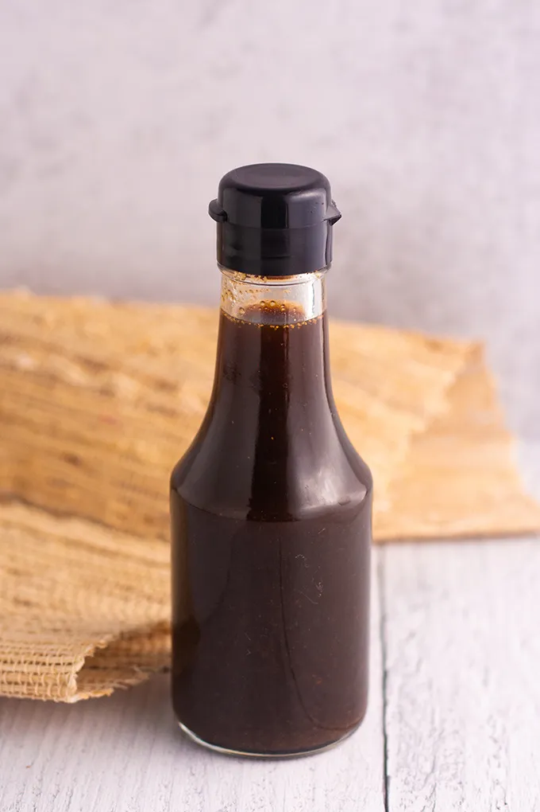

# :apple: Vegetarian Worcestershire Sauce

{ loading=lazy }

| :fork_and_knife_with_plate: Serves | :timer_clock: Total Time |
|:----------------------------------:|:-----------------------: |
| 12 | 7 minutes |

## :salt: Ingredients

- :apple: 1 cup apple cider vinegar
- :takeout_box: 1/3 cup [soy sauce](../../ingredients/soy-sauce.md)
- :maple_leaf: 3 Tbsp (40 g) [brown sugar](../../ingredients/brown-sugar.md)
- :seedling: 1 tsp [Dijon mustard](../dijon-mustard.md)
- :apple: 1/2 tsp ground allspice
- :garlic: 1/2 tsp garlic powder
- :onion: 1/2 tsp onion powder
- :salt: 1/8 tsp black pepper

## :cooking: Cookware

- :bowl_with_spoon: 1 pot
- :bowl_with_spoon: 1 jar
- :bowl_with_spoon: 1 refrigerator

## :pencil: Instructions

### Step 1

Add apple cider vinegar, [soy sauce](../../ingredients/soy-sauce.md), [brown sugar](../../ingredients/brown-sugar.md),
[Dijon mustard](../dijon-mustard.md), ground allspice, garlic powder, onion powder, and black pepper to a pot, and
cover. Turn the heat on low and heat until it is just barely brought to a simmer, about 5 minutes.

### Step 2

Remove from the heat and allow to cool to room temperature.

### Step 3

Store in a jar in the refrigerator for up to 1 to 2 months.

## :link: Source

- <https://www.karissasvegankitchen.com/vegan-worcestershire-sauce/>
