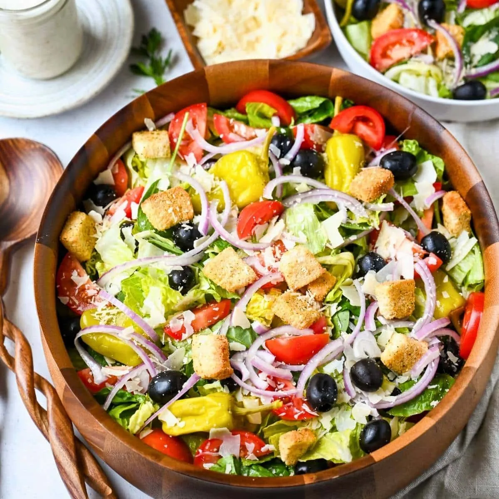

# :green_salad: Light Olive Garden Salad Dressing

{ loading=lazy }

| :fork_and_knife_with_plate: Serves | :timer_clock: Total Time |
|:----------------------------------:|:-----------------------: |
| 12 | 5 minutes |

## :salt: Ingredients

- :avocado: 0.25 cup (50 g) avocado oil [mayonnaise](../dips-and-spreads/mayonnaise.md)
- :olive: 0.25 cup (50 g) extra-virgin olive oil
- :candy: 1 Tbsp (10 g) sugar
- :takeout_box: 0.33 cup (47 g) white wine vinegar
- :tangerine: 1 Tbsp fresh lemon juice
- :cheese_wedge: 4 Tbsp (25 g) Parmesan-Romano cheese blend
- :garlic: 0.25 tsp garlic salt
- :herb: 0.5 tsp [Italian seasoning](../../ingredients/seasonings/italian-seasoning.md)
- :herb: 0.5 tsp (1 g) dried parsley
- :hot_pepper: some fresh cracked black pepper

## :cooking: Cookware

- 1 blender
- 1 refrigerator

## :pencil: Instructions

### Step 1

Combine avocado oil [mayonnaise](../dips-and-spreads/mayonnaise.md) (or an olive oil blend
[mayonnaise](../dips-and-spreads/mayonnaise.md)), extra-virgin olive oil (or extra-light olive oil for a milder
flavor), sugar, white wine vinegar (or white vinegar), fresh lemon juice, shredded Parmesan-Romano cheese blend, garlic
salt, [Italian seasoning](../../ingredients/seasonings/italian-seasoning.md), dried parsley, and fresh cracked black
pepper in a blender and blend until smooth.

### Step 2

Pour desired amount over salad, toss, and serve immediately. Store leftover dressing in an airtight container in the
refrigerator for up to 1 week.

## :link: Source

- <https://ameessavorydish.com/copycat-olive-garden-salad/>
