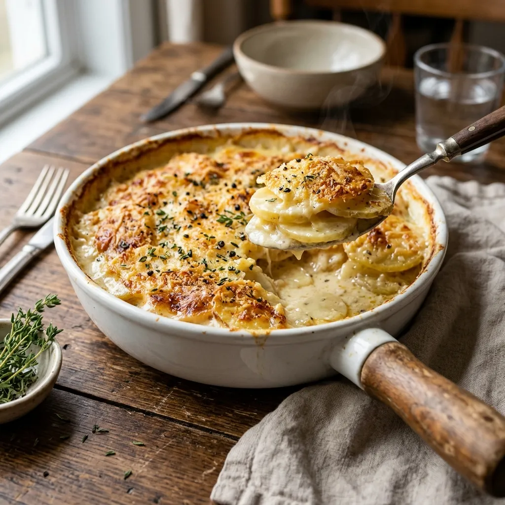

# :potato: Applied Parmesan Scalloped Potatoes

{ loading=lazy }

| :fork_and_knife_with_plate: Serves | :timer_clock: Total Time |
|:----------------------------------:|:-----------------------: |
| 6 | 1.33 hours |

## :salt: Ingredients

- :potato: 24 oz (680 g) Yukon gold potatoes
- :cheese_wedge: 6 oz (170 g) Parmesan cheese
- :glass_of_milk: 12 oz (340 g) heavy cream
- :salt: some salt
- :salt: some pepper
- :butter: some [butter](../../ingredients/butter/butter.md)

## :cooking: Cookware

- :bowl_with_spoon: 1 mixing bowl
- :shallow_pan_of_food: 1 casserole dish
- :package: 1 aluminum foil

## :pencil: Instructions

### Step 1

Preheat oven to 350°F.

### Step 2

Thinly slice Yukon gold potatoes and place them in a mixing bowl.

### Step 3

Add grated Parmesan cheese, heavy cream, salt, and pepper to the bowl with the potatoes. Stir until all the ingredients
are well combined and the potatoes are evenly coated.

### Step 4

Grease a casserole dish with [butter](../../ingredients/butter/butter.md) or oil to prevent sticking.

### Step 5

Layer the sliced potatoes evenly in the greased casserole dish.

### Step 6

Cover the casserole dish with aluminum foil. Bake in the preheated oven for 60 minutes.

### Step 7

After 60 minutes, remove the foil and continue baking for an additional 15 to 20 minutes, or until the top is golden
brown and the potatoes are tender.

## :link: Source

- Applied Kitchen
