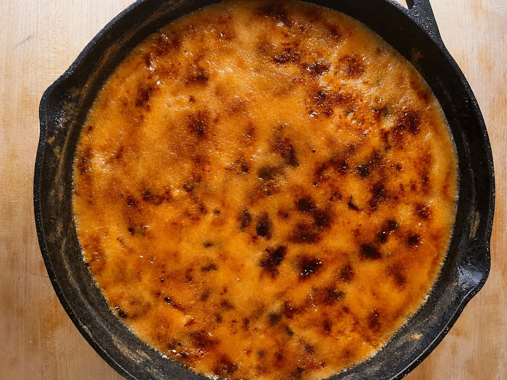

# :corn: Jalapeño Corn Brûlée

{ loading=lazy }

| :fork_and_knife_with_plate: Serves | :timer_clock: Total Time |
|:----------------------------------:|:-----------------------: |
| 8 to 10 | 55 minutes |

## :salt: Ingredients

- :butter: 4 Tbsp (57 g) unsalted [butter](../../ingredients/butter/butter.md)
- :hot_pepper: 1 jalapeño, seeds removed and diced
- :onion: 4 scallions, thinly sliced
- :corn: 2 lbs (907 g) frozen sweet corn, thawed and drained
- :salt: Kosher salt, to taste
- :hot_pepper: Freshly ground black pepper, to taste
- :bread: 1/4 cup (30 g) all-purpose flour
- :glass_of_milk: 2 cups (480 ml) half-and-half
- :candy: 1/2 cup (100 g) granulated sugar

## :cooking: Cookware

- :shallow_pan_of_food: 1 oven
- :shallow_pan_of_food: 1 12-inch cast-iron skillet
- :spoon: 1 wooden spoon
- :shallow_pan_of_food: 1 broiler

## :pencil: Instructions

### Step 1

Preheat the oven to 375°F (190°C).

### Step 2

In a 12-inch cast-iron skillet, melt unsalted [butter](../../ingredients/butter/butter.md) over medium heat.

### Step 3

Add seeded and diced jalapeño and thinly sliced scallions and stir occasionally until they are bright green, about 2
minutes.

### Step 4

Add frozen sweet corn, a good pinch of kosher salt, and freshly ground black pepper. Cook and stir as the kernels
release water and the liquid evaporates, 5 to 10 minutes.

### Step 5

Sprinkle all-purpose flour evenly over the corn and let cook for 1 minute while stirring to eliminate the raw flour
taste.

### Step 6

Slowly pour in half-and-half a little at a time, stirring to fully combine before adding more. Add another hefty pinch
of kosher salt and plenty of freshly ground black pepper. While stirring constantly, let the mixture come up to a bubble
until it is thick, about 5 minutes (it should pass the spoon test, holding a clean line across the back of a wooden
spoon).

### Step 7

Spread the corn pudding into an even layer with the spoon. Transfer to the oven and bake until bubbling around the edges
and lightly golden on top, 20 to 25 minutes.

### Step 8

Remove the skillet from the oven and let it rest for 10 minutes. Switch the broiler to high and move the rack to about 6
inches below the heating element.

### Step 9

Sprinkle granulated sugar in a thin, even layer over the surface. Broil, watching constantly and rotating the skillet
often, until the sugar melts and caramelizes into a golden, crackly crust, 1 to 3 minutes. (If using a kitchen torch,
torch the sugar evenly until bubbling and golden.) Serve directly from the skillet.

## :link: Source

- [The $25 Dinner: Thanksgiving Edition | Cup of Jo](https://cupofjo.com/2026/11/11/the-25-dinner-thanksgiving-edition/)
