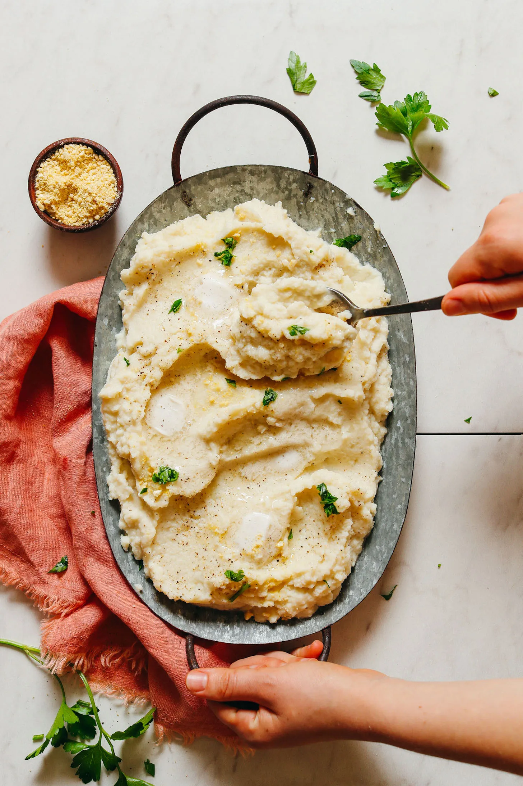

# :garlic: Vegan Garlic Mashed Cauliflower

{ loading=lazy }

| :fork_and_knife_with_plate: Serves | :timer_clock: Total Time |
|:----------------------------------:|:-----------------------: |
| 6 | 23 minutes |

## :salt: Ingredients

- :broccoli: 2 heads cauliflower
- :garlic: 4 cloves garlic
- :butter: 4 Tbsp (68 g) vegan butter (or olive oil)
- :salt: 0.5 tsp sea salt
- :salt: 1 pinch black pepper
- :glass_of_milk: 0.25 cup unsweetened plain almond milk (up to 0.5 cup)
- :herb: fresh parsley or chives (optional)
- :cheese_wedge: [vegan parmesan](../../ingredients/vegan-parmesan.md) cheese (optional)

## :cooking: Cookware

- :bowl_with_spoon: 1 pot
- :bowl_with_spoon: 1 steamer basket
- :shallow_pan_of_food: 1 skillet
- :gear: 1 food processor
- :gear: 1 immersion blender
- :shallow_pan_of_food: 1 saucepan
- :bowl_with_spoon: 1 mixing bowl
- :shallow_pan_of_food: 1 serving platter

## :pencil: Instructions

### Step 1

Cut cauliflower into even florets and steam in a large pot with a steamer basket (covered) until very tender, about 15
to 20 minutes depending on size of pot and cauliflower florets. Remove from heat and set aside uncovered to cool
slightly.

### Step 2

In the meantime, sauté garlic (3 to 4 cloves, minced) in vegan butter (or olive oil) in a small skillet over
medium-low heat for 2 to 3 minutes or until just slightly browned (be careful not to burn). Or, keep the garlic raw
for a punchier, stronger garlic flavor. Turn off heat and set aside.

### Step 3

Transfer half of the cauliflower to a food processor (or use an immersion blender to purée cauliflower in a pot or
saucepan) and process until puréed. The amount of cauliflower you can purée at once will vary based on the size of
your food processor. Add half of the garlic butter as well as half of the sea salt and black pepper and process until
well combined.

### Step 4

Taste and adjust flavor as needed, adding more salt and pepper to taste, garlic for intense garlic flavor, vegan
butter for buttery flavor, or unsweetened plain almond milk (up to 1/2 cup) to help the cauliflower purée. Note: You
could even blend in a little nutritional yeast to add cheesy flavor, or vegan cream cheese for more creaminess
(optional).

### Step 5

Transfer to a mixing bowl or serving platter and cover to keep warm. Repeat this blending and seasoning process until
all the cauliflower is whipped and seasoned.

### Step 6

Garnish with fresh parsley or chives and [vegan parmesan](../../ingredients/vegan-parmesan.md) cheese (optional), and
another sprinkle of salt and pepper and serve hot. Store leftovers covered in the refrigerator up to 3 to 4 days, or
1 month in the freezer. Reheat in the microwave or on the stovetop in a saucepan until hot.

## :link: Source

- <https://minimalistbaker.com/vegan-garlic-mashed-cauliflower/>
