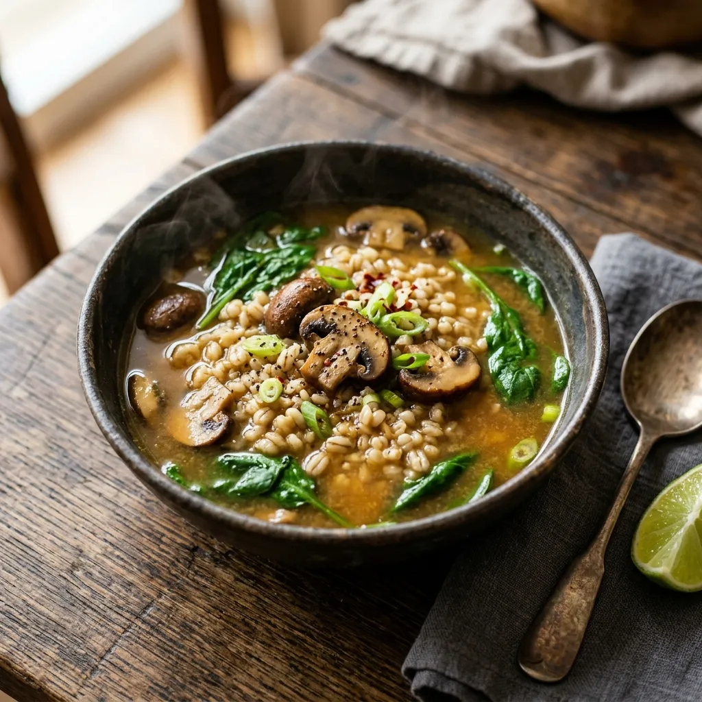

# :stew: Miso-Mushroom Barley Soup

{ loading=lazy }

| :fork_and_knife_with_plate: Serves | :timer_clock: Total Time |
|:----------------------------------:|:-----------------------: |
| 4 | 1 hour |

## :salt: Ingredients

- :olive: 2 Tbsp (25 g) olive oil
- :mushroom: 1.5 lbs (680 g) cremini mushrooms (trimmed and quartered)
- :salt: kosher salt
- :salt: freshly ground black pepper
- :onion: 1 bunch scallions (trimmed, light green and white parts thinly sliced)
- :hot_pepper: 1/4 to 1/2 tsp crushed red pepper
- :stew: 4 cups low-sodium [vegetable broth](../ingredients/vegetable-broth.md)
- :droplet: 2 cups (454 g) water
- :ear_of_rice: 1 cup (213 g) pearl barley
- :takeout_box: 4 tsp (24 g) white miso
- :takeout_box: 1 Tbsp (15 g) [soy sauce](../ingredients/soy-sauce.md)
- :leafy_green: 5 oz (142 g) baby spinach
- :tangerine: 1 lime (optional)

## :cooking: Cookware

- :shallow_pan_of_food: 1 large pot
- :spoon: 1 rubber spatula
- :spoon: 1 wooden spoon

## :pencil: Instructions

### Step 1

In a large pot, heat olive oil over medium-high heat until shimmering. Add cremini mushrooms (trimmed and quartered) and
season lightly with kosher salt and a few grinds of freshly ground black pepper. Cook, stirring occasionally, until the
mushrooms shrink down and release their juices, 6 to 7 minutes.

### Step 2

Stir in scallions (trimmed, light green and white parts thinly sliced) and crushed red pepper and cook until softened,
about 2 minutes.

### Step 3

Pour in low-sodium [vegetable broth](../ingredients/vegetable-broth.md), water, and pearl barley. Raise the heat to
bring the liquid to a boil, then lower heat to maintain a simmer. Cook, stirring occasionally, until the barley is
tender, about 30 minutes.

### Step 4

During the last 5 minutes of cooking, stir in white miso and [soy sauce](../ingredients/soy-sauce.md). Use a rubber
spatula or wooden spoon to seek out any miso clumps, flattening them against the side of the pot to help dissolve.

### Step 5

Add baby spinach in batches, adding a handful and stirring until wilted. Taste and season with more
[soy sauce](../ingredients/soy-sauce.md) or salt as needed. Squeeze in half a lime (optional), if using, and cut the
rest into wedges for serving. Finish with some freshly ground black pepper and serve.

!!! tip

    - **Texture:** Quartering the mushrooms allows them to retain bite, but you can thinly slice them if you prefer a softer, more tender texture.
    - **Salting:** Resist the urge to salt heavily during the bulk of cooking; the miso and soy sauce add significant sodium at the end.
    - **Reheating:** The soup thickens as it sits; add more water or broth when reheating.
    - **Variations:** Swap pearl barley for farro, or replace baby spinach with chopped bok choy or sturdy greens.

## :link: Source

- [NYT Cooking](https://cooking.nytimes.com/recipes/1025076-miso-mushroom-barley-soup)
